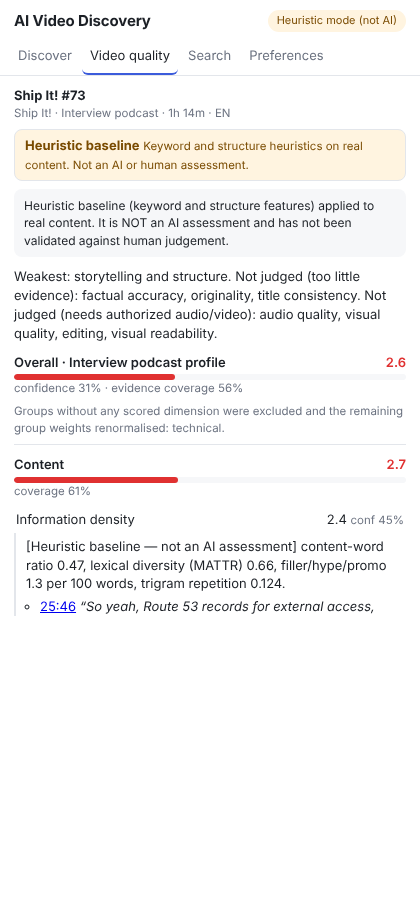

# AI Video Discovery

Open-source, self-hosted software that assesses YouTube videos by the **quality of their
content, not their popularity**, explains each judgement with evidence, and recommends videos
to you without letting your preferences change those judgements.

> A video with 100 views can be better than a video with 10 million views.

You run it: on your own computer (`avd start`), on a server you operate (Docker Compose), or
through someone else's instance if you choose to. There is no central service, account system
or model endpoint run by the project, and none is needed
([who pays for what](docs/infrastructure-costs.md)).

## What makes it different

* **Popularity-blind.** Views, likes, subscriber counts and channel identity never reach the
  evaluator or the intrinsic score. This is enforced by the input type and checked by tests and
  by a benchmark (inflating popularity ×1000 must change nothing).
* **Multidimensional and genre-aware.** 14 dimensions in three groups (content, presentation,
  technical), each with an anchored 1–5 rubric. They are weighted by genre profile, so a
  lecture and a story are not judged alike.
* **Content quality, not production quality.** A well-reasoned talk filmed on a phone is not
  penalised on content dimensions.
* **Evidence or abstention.** Every AI judgement cites transcript segments that are verified
  verbatim. Without evidence, a dimension is "insufficient evidence", never a guessed number.
  Uncertainty is reported, not hidden.
* **Personal ranking, unchanged quality.** Your interests and priorities change the order of
  recommendations, never a video's assessment. Small creators are not filtered out, and you can
  boost them.
* **Reproducible.** Models (with weights digests), prompts, rubrics and configurations are
  versioned, and evaluations can be exported in a portable, rights-aware format.

## Status: read this first

| | State |
|---|---|
| Runs without any central server | **yes**: local mode (SQLite, embedded worker) and self-hosted full stack |
| AI evaluation implemented | yes: local models through Ollama (no key, $0) and hosted APIs (optional) |
| AI evaluation **run on real models** | **not yet: 0 real model calls.** The local-model path is tested against a protocol mock. The development environment cannot download Ollama or model weights. No hosted model has been run either. **You can be first:** [the one-transcript experiment](docs/first-experiment.md) |
| What you see without a model | a keyword/structure **heuristic baseline**, labelled "Heuristic mode (not AI)" everywhere |
| Accuracy against human judgement | **unknown: 0 human ratings.** Blind annotation works online and as [offline rating packets](docs/annotation-pilot.md) for volunteers; no raters yet |
| Release gates | 12 gates: 1 passes, 7 are blocked by missing human labels, 4 by the absence of AI inference (Phase 3 record, `avd gates status`). Not release-ready |
| Platforms | Linux tested end to end (`scripts/e2e/full_local.py`, including the extension in Chromium). **macOS and Windows not tested** |

Synthetic demo videos (written for this project) are labelled `synthetic_demo` everywhere and
do not exist on YouTube. Phase records with audits and measured results:
[Phase 2](docs/phase2.md), [Phase 3](docs/phase3.md), [Phase 3.1](docs/phase3_1-report.md),
[Phase 3.2](docs/phase3_2-report.md), [Phase 3.3](docs/phase3_3-report.md), [Phase 3.4](docs/phase3_4-report.md),
[Phase 3.5](docs/phase3_5-report.md).



## Install and run on your computer

Linux and macOS (Windows PowerShell: [`docs/local-setup.md`](docs/local-setup.md)):

```bash
git clone https://github.com/Apostal322/youtubeHelperWhatWhatch
cd youtubeHelperWhatWhatch/backend
python3 -m venv .venv && source .venv/bin/activate && pip install -e .
avd start --demo        # http://127.0.0.1:8000 (this computer only); synthetic examples queued
```

A ten-minute walkthrough of what it does (submit, progress, breakdown, evidence, search,
recommendations), with what each output really is: [`docs/demo.md`](docs/demo.md).

Then build the extension (`cd extension && npm ci && npm run build`) and load `extension/dist`
in `chrome://extensions` (*Developer mode* → *Load unpacked*). It connects to your local backend
automatically.

* **Local AI:**
  1. `avd local doctor` recommends a model for your hardware and downloads nothing;
  2. `avd local pull qwen3.5:4b --approve-gb 3` downloads it once you approve the size;
  3. `avd start --provider ollama` uses it.

  Details and safety properties: [`docs/local-ai.md`](docs/local-ai.md).
* **Content:** a new install starts empty. You can:
  * add synthetic examples (`--demo`);
  * import the licensed podcast pilot (`avd dataset import`);
  * submit transcripts you have the right to share.

  Being publicly viewable on YouTube is not permission to download
  ([`docs/permissions.md`](docs/permissions.md)).
* **Search quality:** the default `hashing` embedder is a keyword-hash fallback and can surface
  unrelated videos. For real use, `avd embeddings fetch-model` and `AVD_EMBEDDING_PROVIDER=onnx_minilm`.
* **Diagnostics:** `avd doctor`; in the extension, *Preferences → Backend*.

## Run it for a group (self-hosted)

```bash
docker compose --profile lite up -d --build lite     # one container, SQLite
docker compose up -d --build                         # PostgreSQL+pgvector, Redis, Celery
```

Ports bind to `127.0.0.1`. A shared server sets `AVD_DEPLOYMENT_MODE=server`. The API then
refuses to start without:

* an admin token;
* explicit allowed hosts;
* a registration policy (invite codes by default);
* a non-default database password.

Put a TLS reverse proxy in front. Backups, upgrades and recovery:
[`docs/self-hosting.md`](docs/self-hosting.md).

## AI providers

| Provider | Setting | Data leaves the instance? | Cost |
|---|---|---|---|
| Heuristic baseline (default) | `AVD_LLM_PROVIDER=heuristic` | no | none (not AI) |
| Ollama, local open-weight models | `AVD_LLM_PROVIDER=ollama` | no (endpoint must be local/private) | your hardware |
| OpenAI-compatible server (local or remote) | `AVD_LLM_PROVIDER=openai_compatible` | if the URL is remote | per that server |
| Anthropic | `AVD_LLM_PROVIDER=anthropic` + key | yes, to Anthropic | your account, budget-capped |

Remote use is always an explicit operator choice. There is no silent fallback to a paid API.
The assessment schema is the same for every provider, and each result records the model and
weights digest that produced it ([`docs/model-configuration.md`](docs/model-configuration.md)).

## Browser extension and privacy

* The extension talks only to the backend you choose: local by default, with no built-in
  remote server.
* A remote backend must use HTTPS. You see its diagnostics and give explicit consent before
  anything is sent.
* The toolbar badge never reports the videos you watch to a remote server unless you enable it
  separately.
* Instances have no telemetry.
* Users can export and delete their data, and operators can back up, restore and clear it
  ([`docs/privacy.md`](docs/privacy.md)).

## Research method

Quality is judged per dimension against anchored rubrics, using authorized transcripts (and
audio/video where authorized). Judgements are verified against the cited evidence and
aggregated by genre profile with explicit coverage and confidence. Validation needs independent
human raters: a blind annotation protocol, inter-rater agreement and sealed held-out data
([`docs/evaluation.md`](docs/evaluation.md), [`docs/annotation.md`](docs/annotation.md)). These
safeguards apply to every installation. Self-hosting changes who runs the software, not what
counts as evidence. **No score from this software should be read as an objective truth about a
video.** Scores are transparent, reproducible assessments with stated uncertainty.

## Contributing

Start with [`CONTRIBUTING.md`](CONTRIBUTING.md): setup takes five minutes, and no GPU or key is
needed. Also see:

* [contributing to the research](docs/research-contributing.md): model runs, ratings, relevance
  judgments, reproducing benchmarks;
* [running a local model and sharing the result](docs/volunteer-pilot.md) (Windows, macOS, Linux);
* [rating transcripts as a volunteer](docs/annotation-pilot.md): one offline file, no installation;
* [good first issues](docs/good-first-issues.md);
* [extension points](docs/extending.md), including a custom-evaluator example;
* [architecture](docs/architecture.md);
* [roadmap](docs/roadmap.md);
* [security policy](SECURITY.md);
* [code of conduct](CODE_OF_CONDUCT.md);
* [getting help](SUPPORT.md).

## Checks

```bash
cd backend && ruff check avd tests && mypy avd && pytest -q          # SQLite only
AVD_TEST_DATABASE_URL=postgresql+psycopg://... AVD_TEST_REDIS_URL=redis://... pytest -q   # + pgvector/Redis
cd extension && npm run typecheck && npm test && npm run build
python scripts/e2e/full_local.py --avd backend/.venv/bin/avd    # real processes; add --chromium <path> for the extension
```

## Documentation

| Topic | Documents |
|---|---|
| Install | [local setup (Linux/macOS/Windows)](docs/local-setup.md) · [self-hosting](docs/self-hosting.md) · [local AI](docs/local-ai.md) · [providers](docs/model-configuration.md) |
| Data | [privacy and data ownership](docs/privacy.md) · [evaluation export format](docs/evaluation-export.md) · [content permissions](docs/permissions.md) · [licensing and provenance](docs/licensing.md) |
| Design | [architecture](docs/architecture.md) · [extending](docs/extending.md) · [API](docs/api.md) · [security](docs/security.md) · [infrastructure costs](docs/infrastructure-costs.md) |
| Research | [evaluation framework](docs/evaluation.md) · [annotation](docs/annotation.md) · [reproducibility](docs/reproducibility.md) · [local-model protocol](docs/research/local-models.md) · [research contributions](docs/research-contributing.md) · [volunteer model runs](docs/volunteer-pilot.md) · [relevance protocol](benchmarks/datasets/relevance_v1/README.md) |
| History | [Phase 2](docs/phase2.md) · [Phase 3](docs/phase3.md) · [Phase 3.1](docs/phase3_1-report.md) · [Phase 3.2](docs/phase3_2-report.md) · [Phase 3.3](docs/phase3_3-report.md) · [Phase 3.4](docs/phase3_4-report.md) · [release checklist](docs/release-checklist.md) · [roadmap](docs/roadmap.md) |

## Repository layout

```
backend/            FastAPI app, evaluation engine, workers, recommender, benchmarks, CLI (avd)
  avd/migrations/   Alembic migrations (shipped inside the package)
  tests/            pytest suite (SQLite always; PostgreSQL/pgvector + Redis when configured)
extension/          Chrome MV3 extension (React + TypeScript + Vite)
data/fixtures/      Synthetic demo videos with original transcripts
benchmarks/         Datasets (manifests only for licensed data) and baseline reports
docs/               Setup, design, research and phase records
```

## License

Declared: **Apache-2.0** for code, **CC0-1.0** for synthetic fixtures and benchmark data. The
`LICENSE` file is not yet in the repository; adding it is the owner's decision. The exact
change (the Apache-2.0 text from apache.org) is prepared in a separate draft pull request for the
owner to approve or reject ([`docs/licensing.md`](docs/licensing.md)). The software license grants nothing about
third-party video content.
